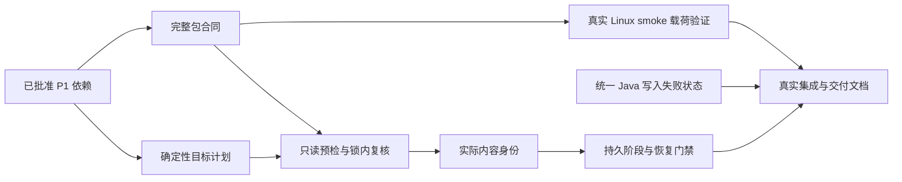

# Development Plan — 完整包与逐目标受控升级

## Delivery boundary

- 任务：`20260925-full-package-release-refactor`；依据已批准的 `request-analysis.md` 与 `prd.md`，验收编号 AC-01～AC-12 不变。
- 已接受范围变更 `CR-20260926-PROCESS`：本轮交付可复用的完整包发布流程。既有任务图、AC-01～AC-12、TC-01～TC-14、完整 C7（含 Node/PS/AST/diff）及 C6-J 均保留；不跟踪或合并持续变化的主程序 main，不以当前主仓版本构建、三服实时计划、实际部署或应用 main 合入验证作为本轮门禁。此前这些当前版本/现场发布门禁均由本范围取代。
- 默认产品写入仓库：`D:/IntRuoyiWorktree/full-package-release-maintenance`，从维护仓 `3f3aabdc82ab5e85e2f872173a665a361f022725` 建立的任务 worktree。下文除 T6J 外的产品路径均相对该目录。T6J 使用主管建立的 `D:/IntRuoyiWorktree/full-package-release-application`，历史开发起点为 `840b9ef`，本轮接口回归固定在任务提交 `af5acd8266e4ca1eb71e1d0581ece77fa4743d48`；backend 根为其 `IntRuoyiBackend`。
- 中央任务目录：`D:/ProjectPackage/Int/IntRuoyiMaintance/doc/tasks/20260925-full-package-release-refactor`。主管独占 `task-state.json`；执行者仅追加自己任务的 `execution-log.md`；独立测试者仅写 `test-report.md`；分解者独占本文件与 `test-plan.md`。
- 应用合同仅读取上述固定任务 worktree 的 `af5acd8266e4ca1eb71e1d0581ece77fa4743d48` 七文件接口切片，保留为 T6J 兼容基线和待交接成果。另一个两入口任务的 worktree、未提交内容和 P2～P5 均不在本任务写入范围。不修改应用 UI；T6J 的写入后失败语义修复限定为四个生产文件和三个测试，保持该固定合同的四参数 acceptTest，不导入第五个 recovery-set 参数。
- 不连接测试/正式/备份服务器，不运行真实发布、恢复、清锁或业务 E2E。本地受控验证证明流程合同；不得据此宣称当前主程序版本或三台服务器实际就绪。未来发布须另行指定已提交来源并完成目标环境授权、预检与业务验收。
- 每个任务先记录 BDD，运行针对当前缺陷的 RED，再实现、GREEN、相关 REGRESSION；不能用新增断言恒真或源码字符串存在代替行为 RED。

## Frozen implementation contracts

1. 完整产品范围保留 `intruoyi`（backend + frontend）与 `full`（再包含 Website）。OnlyOffice 是构建时固定的显式选项。标准 app-release 拒绝单组件及目标侧组件覆盖；不静默转成 full。所有纳入的镜像、静态载荷和必需模板必须进入包摘要。
2. 包冻结后只读。目标参数替换、Website nginx 渲染、`.env`、计划、回执只能写入包外控制目录；不得因环境变化重写 `releaseDir` 内模板。保留当前 packageDigest/manifestDigest 算法和 tested v2 来源绑定。
3. 计划身份固定包含包双摘要/releaseTag、环境/主机、数据库身份（含实际实例身份）、执行器与计划器摘要、采集时间、schema/完整相关迁移台账/非秘密配置/持久挂载指纹及有序动作。确定性针对相同采集输入；不能让当前时间混入动作排序。配置指纹使用非秘密字段白名单，不保存凭据明文或其可猜测摘要。
4. 顺序固定：本地完整包校验 → 目标只读采集/前提检查/计划 → 检查未解决的持久部署状态 → 获取既有租约锁 → 锁内重采与指纹比对 → 持久记录即将写入的阶段 → 迁移/安装 → 完整验证 → 本任务部署临时物清理与最终记录。运行写入前任何不满足均失败；控制写入与运行/业务写入分别记录。
5. 普通 app-release 不自动创建持久数据目录、挂载、控制表或锁存储过程，不启动/重建 MySQL、Redis、MinIO。必须以现有目标资源身份和 schema 为前提；只重建所选应用。所需平台工具须明确归入包载荷或可核验的平台前提。
6. 镜像证据贯通包内 `docker-build-evidence.json` 的 imageId、加载后的镜像与实际容器 `.Image`；tag 只辅助定位。Website 等静态载荷以 manifest 内容摘要核对实际部署文件集合，不能只核对 `index.html` 存在。
7. 持久证据位置固定为包外、不会随本轮 `deployControlLocalRoot` 清理的目标控制状态根：`$RemoteAppDir/.release-state/$Environment/`，包含 `operations/<attemptId>.json` 与当前门禁记录。现有数据库 lockOperationId 保留 `$Environment-$ReleaseTag`；内部 attemptId 固定为 `SHA256(UTF8(lockOperationId + "\n" + leaseToken))`，使同标签不同租约的历史文件不互相覆盖。记录保存 attemptId、lockOperationId 和 leaseTokenDigest，不保存租约原文；恢复入口用既有参数重算，无新增外部参数或数据库字段。首次同 attempt 文件已存在时拒绝覆盖，同次阶段更新才允许同文件系统原子替换；未解决的旧 gate 阻断新租约。状态根及其可写权限属于显式平台前提；常规部署不在预检中自动补齐。标识/环境必须安全校验，证据中不存秘密。若现有正式配置已有同等持久目录，执行者须先报告具体合同，由主管一次性调整本约定，禁止同时维护两套互不相认的门禁。
8. 在首次可能运行写入之前持久保存原身份、目标身份、阶段 STARTED 与 writeAttempted；完成后保存阶段结果。持久门禁必须由部署入口和显式锁恢复入口实际读取，并在取锁后复核。可能写入失败/进程中断/观测未知均阻断后续部署；过期心跳不构成恢复许可。没有新增自动回滚或自动恢复。
9. 最终验收包含身份、迁移、配置与健康；任务临时物清理和历史/回执落盘也须完成并可核对。最终化过程中出错保留 FINALIZING/RECOVERY_REQUIRED 等非成功门禁，不先释放 APPLIED 再执行可能失败的清理。只有全部最终化步骤成功才输出成功并允许下一部署；不能以一个 JSON 的 SUCCESS 覆盖实际锁/历史写入失败。
10. 不创建新的通用发布框架。优先修改现有 Python 计划器、PowerShell 生产函数；只有持久阶段/回执序列化允许抽取一个小型 `ReleaseDeploymentEvidence.psm1`，且真实部署必须消费它。原 `release_deployment_transaction.py` 的文件模拟不能充当新生产事务或真实引擎证明。
11. 既有排程 smoke 功能的 Linux 依赖在构建时按锁文件准备并随完整包交付，部署时不再 `npm install`。保持现有 Playwright `1.60.0`、xlsx `0.18.5` 和官方运行镜像 `mcr.microsoft.com/playwright:v1.60.0-noble`；镜像本身也纳入完整包身份和字节清单。准备器代码合同的行为验证归 T2，真实 Linux 依赖准备、库加载及浏览器验证归 T2P。不得用其它版本/镜像/依赖源、伪造 node_modules 或测试替身通过 T2P。

新持久状态根是明确的平台准备前提。运维文档必须新增单独的准备步骤：核对目标服务器/部署账号、确认控制路径不在每版应用临时目录或受保护共享盘、核对父目录/权限/备份保留约定；经后续明确授权再执行对应服务器的 `install -d -m 0700 -o <部署用户> -g <部署组> -- <已核对的持久控制路径>/operations`，随后用该部署账号验证目录归属与可写性。以上占位值必须来自目标正式配置，不得原样执行；本任务只写 runbook，不在三服执行 bootstrap，也不把 mkdir 加回常规预检。目录缺失时错误指向该正式准备步骤。

## Task graph and scheduling

维护仓执行链为 T1 → {T2、T3} → T4 → T5 → T6；T2P 在 T2 之后单独验证真实 Linux 载荷；T6J 无任务依赖，可从开始与 T1 并行。T4 的前提是 T2 稳定代码合同已独立验收和 T3 完成，不依赖外部镜像获取；T7 必须等待 T2P、T6 和 T6J 全部完成，T2P 阻塞期间 AC-02 和整体任务不得标完成。T6J 的历史起点 `840b9ef` 与批准差异证据保留；当前使用 `D:/IntRuoyiWorktree/full-package-release-application` 的固定 `af5acd8266e4ca1eb71e1d0581ece77fa4743d48` 接口切片，槽位 35 和执行 guard 的归属规则仍适用，不依赖维护仓 T1 的代码或测试。并行上限按实际槽位决定，每一任务由独立测试者验证后才解锁依赖。T6J 与维护仓各任务、以及 T2/T3 之间的生产与测试写入路径均不重叠：主管事先在 execution-log 预分配任务区段，各执行者只能修改所属区段，禁止整文件覆盖、重排或修改对方日志。T2P 只读取 T2 已验收生产合同并写独立真实集成测试和任务缓存；若发现生产缺陷，返回 T2 修复，不能并发写正在由 T4～T6 修改的发布脚本。共享已有依赖测试只能读取，运行时使用不同 pytest 临时目录。`publish-int-ruoyi.ps1`、包治理测试和锁测试均高风险共享文件，任何时候只有一个执行者写。T7 测试者不得修代码；失败返回所属 T2～T6J 执行者，最多三轮修复/复验。

## T1 — 显式纳入已批准的 P1 依赖

- task_id: T1
- title: 在本任务冻结基线复现并选择性接入 P1
- objective: 在维护任务起点 `3f3aabdc82ab5e85e2f872173a665a361f022725` 证明缺少已批准的 supersession/依赖顺序/锁 SQL 修复，再只纳入 `772fc46` 的相关补丁，建立安全的任务隔离 MySQL 测试入口；已完成的历史 RED/GREEN 保留，不追踪后续主程序主线变化。
- dependency_ids: []
- affected_paths / write_scope（精确 15 个获批复用路径）：
  - `ops/deploy/publish-int-ruoyi.ps1`
  - `ops/release/release_build_preflight.py`
  - `ops/release/release_migration_manifest.py`
  - `ops/release/release_migration_policy_gate.py`
  - `ops/release/release_migration_preflight.py`
  - `ops/release/release_preflight_plan.py`
  - `ops/release/release_schema_rehearsal.py`
  - `scripts/tests/test_release_build_preflight_cache.py`
  - `scripts/tests/test_release_migration_preflight_matrix.py`
  - `scripts/tests/test_release_migration_supersession_contract.py`
  - `scripts/tests/test_release_operation_lock_mysql_behavior.py`
  - `scripts/tests/test_release_package_governance.py`
  - `scripts/tests/test_release_preflight_r20_regressions.py`
  - `scripts/tests/test_release_schema_rehearsal.py`
  - `scripts/tests/test_release_sql_preflight_gate.py`
- 额外任务测试辅助写入：`scripts/tests/release_test_runtime.py`（任务配置解析、目标隔离验证和共用执行辅助）；不得写产品运行配置。
- acceptance_ids: AC-03、AC-04、AC-06、AC-11、AC-12 的前置回归；不单凭 P1 标记最终 AC 已完成。
- validation_steps:
  1. 按上述路径审查冻结基线的 `git diff 3f3aabd..772fc46 -- <paths>`，只迁入当前任务需要的范围增量；不依赖合并提交的父序号，禁止整体 cherry-pick、整文件替换或导入 `d316da9`。先引入测试，记录该冻结基线的真实失败，再引入对应生产差异。
  2. P1 MySQL 测试执行之前去除 `int-ruoyi-mysql` 硬编码；由 `RELEASE_TEST_MYSQL_RUNTIME_CONFIG` 读取已存在任务 JSON，验证 task/container/volume 归属，不提供共享库默认值，缺配置直接失败。
  3. 执行 test-plan 的 C1，覆盖真实生成的 acquire/release/fence SQL、超时所有权保护、supersession、依赖拓扑和既有数据 preflight。
- done_definition: 精确纳入清单、RED 与 GREEN 记录完整，真实任务 MySQL 测试通过，未访问共享数据库，差异中没有另一任务文档、input preparation 或 P2～P5 应用改动；独立测试者验收通过。

## T2 — 收紧完整且不可变的程序包合同

- task_id: T2
- title: 固定组件集合和全部安装输入
- objective: 构建和晋级共用严格包合同，目标参数不能改变受管组件；所有渲染在包外进行，不再使用包外模板补齐；实现既有 smoke 功能的锁文件 Linux 载荷准备器及部署时无在线安装合同。
- dependency_ids: [T1]
- affected_paths / write_scope:
  - `ops/deploy/publish-int-ruoyi.ps1`（组件解析、制品选择、包 manifest、Compose/Website 模板准备、宿主工具合同）
  - `ops/release/lib/ReleasePackageGovernance.psm1`
  - `ops/release/smoke/package.json`（仅既有 smoke 依赖与脚本）
  - `ops/release/smoke/package-lock.json`（固定 Playwright 1.60.0 / xlsx 0.18.5 的真实锁文件）
  - `scripts/tests/test_release_full_package_contract.py`（新增行为测试）
  - `scripts/tests/test_release_package_governance.py`
  - `scripts/tests/test_app_release_package_governance.py`
  - `scripts/tests/test_runtime_control_frontend_deploy_contract.py`
  - `scripts/tests/publish_frontend_deploy_sql_gate_contract.test.mjs`
- acceptance_ids: AC-01、AC-02、AC-12
- validation_steps: C2；实际导入 PowerShell 治理模块/AST 中生产函数，覆盖 intruoyi/full、OnlyOffice 两种状态、单组件拒绝、部署覆盖拒绝、所有必需输入缺失、工作区同名模板存在也拒绝；两种目标渲染前后包每个文件摘要与双摘要不变；保留 tested v2/来源选择/正式授权合同。准备器行为/负例验证缺官方镜像、锁文件或生成载荷时明确失败，构建侧固定版本，部署侧不能执行 npm install/临时下载补齐；这些代码测试不能作为真实 Linux 载荷已可用的证据。
- done_definition: 所有受管组件身份/载荷/控制模板有完整清单，旧包缺新合同返回重建错误；没有模板 fallback、目标凭据或业务快照进入包；所有目标临时渲染路径在包外；组件/模板/准备器代码行为和回归由独立测试者通过，记录受验源码身份后允许 T4 使用稳定合同。真实载荷准备和库/浏览器验证仍由 T2P 必做，T2 单独通过不能关闭 AC-02 或整体任务。

## T2P — 真实 Linux smoke 载荷准备与验证

- task_id: T2P
- title: 用既定官方镜像验证完整包中的真实 smoke 依赖
- objective: 在 T2 已独立验收的生产准备器上生成真实 Linux 依赖载荷，证明锁定模块、浏览器和随包镜像可用，并记录实际制品字节身份；不新增 smoke 产品功能。
- dependency_ids: [T2]
- external prerequisite: 本地须可用同一个官方 `mcr.microsoft.com/playwright:v1.60.0-noble` 镜像。截至拆分时本地缺失；直接 docker pull，以及直连/Windows 7890 代理的官方 manifest 读取均报 TLS EOF。主管已向用户请求同版本官方镜像的离线路径或可用代理；此依赖未满足时 T2P 保持阻塞，不改版本、镜像或依赖源，不用假成功代替。镜像可用后，锁文件列出的依赖也须可实际获取；失败仍报告确切前提。
- affected_paths: 只读 T2 的生产准备函数、`ops/release/smoke/package.json`、`ops/release/smoke/package-lock.json`、包治理与镜像清单；读取实际包生成结果。
- write_scope:
  - `scripts/tests/test_scheduler_smoke_linux_payload_integration.py`（新增，仅本功能真实 Linux 集成测试）
  - `E:/Int/CacheData/IntRuoyi/tests/full-package-release-refactor/smoke-payload/`（任务专属生成载荷与脱敏证据，不提交 node_modules/镜像归档）
  - 所属 execution-log 区段；生产准备器缺陷返回 T2 修复，不在本任务并发改发布脚本。
- acceptance_ids: AC-02、AC-08、AC-12；AC-02 的真实制品证据必须由此补齐。
- validation_steps: C2P；使用生产准备器在指定 Linux 镜像内按锁文件实际生成依赖载荷，核对 playwright=1.60.0、xlsx=0.18.5 及依赖锁定结果；在相同实际运行镜像中离线解包并真实 require 两库、执行 xlsx 往返和启动/关闭真实浏览器。记录官方镜像引用、实际 imageId（sha256）、已有 RepoDigests/离线来源与归档 sha256；核对随包镜像及 dependencies.tar 的实际字节长度/sha256，确认 packageDigest/manifestDigest 绑定这些内容。运行验证阶段禁网，证明无需部署时 npm install；缺档/篡改反例仍拒绝。
- done_definition: 独立测试者确认真实 Linux 生成物、锁定模块、实际库/浏览器执行、镜像身份和包字节证据全部通过；模块空壳、假 tar、mock 的 subprocess 成功不算通过。外部镜像不可用只阻塞 T2P 与最终 T7，不回退验收要求；既有 TC-03 等用例全部保留。

## T3 — 目标状态绑定与严格迁移计划

- task_id: T3
- title: 相同包按各目标真实起点形成固定计划
- objective: 保留已批准 supersession 和 metadata-only 等价规则，拒绝未知/失败/运行中历史和摘要漂移；计划绑定输入身份，支持锁内比较而非重新猜测。
- dependency_ids: [T1]
- affected_paths / write_scope:
  - `ops/release/release_preflight_plan.py`
  - `ops/release/release_target_state_collector.py`（状态规范化/指纹，实际远端采集由 T4 接入）
  - `ops/release/release_deploy_executor.py`（现有执行合同接受严格动作集，不另建执行器）
  - `scripts/tests/test_release_target_bound_plan.py`（新增）
  - `scripts/tests/test_release_preflight_plan_order.py`
  - `scripts/tests/test_release_migration_preflight_matrix.py`
  - `scripts/tests/test_release_preflight_r20_regressions.py`
- acceptance_ids: AC-03、AC-04、AC-05
- validation_steps: C3；同包三种起点实际 Python API 和 CLI，完整台账及失败/未知状态、环、缺依赖、重复迁移 ID、合法 supersession/等价摘要；逐个改变包/目标/schema/ledger/mount/config/executor 指纹验证计划拒绝；执行器仅执行计划 APPLY。
- done_definition: 非法状态返回稳定可定位阻断代码，相同输入动作确定；计划缺绑定/不匹配即拒绝；无任意摘要白名单、不自动修台账、不在包内写计划；独立测试通过。

## T4 — 把只读预检移到首个运行写入之前

- task_id: T4
- title: 真实采集、平台前提和锁内复核
- objective: 调整生产主链和实际 shell/SQL，使只读预检失败保持运行状态；获取控制锁后重新采集绑定状态，通过才进入计划内写入。
- dependency_ids: [T2, T3]
- dependency qualification: T2 的组件/模板/准备器实现及行为负例必须先独立通过并固定代码身份；T2P 的真实 Linux 制品验证保留为最终门禁，不阻止本任务独立代码工作。
- package toolchain gate: 对应 FR-02/FR-07、AC-05/AC-12，在任何远端写入前复用 manifest 维护 `sourceRoots.approvedCommit/commit`，核对当前实际部署执行器所在维护 Git HEAD 与两者一致，相关 PowerShell/Python/模块工具链源码的 tracked 和 untracked 状态均干净。保留 Java 既有 PowerShell 配置 SHA 校验；新增包级固定防止三次目标规划之间更换工具链后重新 pin 配置。允许不同本地检出路径，不要求历史绝对路径相同，不读取或要求应用源码存在，不另建执行器框架。实现与测试仅用已批准的发布 PS 和 readonly-deploy-gate 测试路径。
- application startup contract: 普通 app-release 的每一条应用和 Website `docker compose up` 必须显式包含 `--no-deps --pull never`；包含 OnlyOffice 时同样适用，不因选中 OnlyOffice 恢复依赖启动或拉取。T2 固定的 runtimeImages（含 smoke 镜像）须从包内制品加载，所选应用所需镜像未能在目标已加载集合中确认时，启动前明确拒绝；禁止部署时从 registry 补齐。T4 负责此实际执行策略及顺序接入，T5 继续负责 imageId 精确验收，不能以启动参数代替内容身份验证。
- target preflight package contract: 现有只读 checks 仅在构建时读取应用源码，尚未随包。T4 必须在 `Copy-RequiredDatabaseSqlScripts` / `New-ReleaseRequiredSqlManifestEntries` 中，从已冻结源码复制对应 checks 到包内 `target-preflight/`，为迁移记录 `targetPreflight={reference,sha256,readOnly}`，且实际文件受 artifacts/packageDigest 覆盖。复用现有 `ops/release/release_target_preflight_contract.py` 校验，不建立新的 SQL 安全框架。部署只消费包内 checks，对 test/prod/backup 的实际选定目标执行；缺文件、摘要漂移、缺少 PASS 或非只读均拒绝，执行前取锁后重新核对目标事实。当前本地验收用任务隔离资源验证三个环境的真实调用合同，不据此获得三服操作授权。
- affected_paths / write_scope:
  - `ops/deploy/publish-int-ruoyi.ps1`（Write/Read-ReleasePreflightPlan、远端采集、锁入口、主部署段、平台前提检查，以及 Copy-RequiredDatabaseSqlScripts / New-ReleaseRequiredSqlManifestEntries 的只读 checks 打包合同）
  - `ops/release/lib/ReleasePackageGovernance.psm1`（仅 targetPreflight 缺件、sha256、readOnly 及引用一致性校验）
  - `scripts/tests/test_release_full_package_contract.py`（仅上述 targetPreflight 合同的行为正反例）
  - `scripts/tests/test_release_readonly_deploy_gate.py`（新增）
  - `scripts/tests/test_release_operation_lock_mysql_behavior.py`
  - `scripts/tests/test_release_workflow_preflight.py`
  - `scripts/tests/test_release_sql_preflight_gate.py`
- acceptance_ids: AC-04、AC-05、AC-06、AC-07、AC-12
- validation_steps: C4；实际 PS 函数调用序列与生成 shell/SQL，缺挂载、错数据库实例、缺控制 schema、配置/工具前提缺失、数据预检失败逐一注入；失败前后比对隔离文件/容器/真实 MySQL schema/历史行；取得锁后修改各关键状态，旧计划拒绝；控制锁写入单独计数。通过实际生产调用覆盖 intruoyi/full × OnlyOffice 纳入/未纳入，观察每条应用/Website compose up 都传入 `--no-deps --pull never`；缺少包内应加载镜像时明确失败且没有启动、registry pull 或平台依赖补齐调用，不仅检查源码字符串。
- required regression: 额外执行完整 C2；C4 观察生产 builder 从冻结源码复制检查文件、生成 targetPreflight/实际 artifact 摘要，再由部署仅从包内读取并对三个目标环境执行。缺件/漂移/缺 PASS/非只读/引用不一致负例以及锁内事实变化必须阻断。非 schema 的 APPLY 必须按现有 policy 与实际 SQL 元数据强制 preflight，不能仅信 manifest 的 requiresTargetPreflight；省略或伪改为 false 不能绕过必需检查。主审已批准新增上述治理模块及其精确测试路径，仅限 targetPreflight 合同；其它路径仍需报告具体缺口后再确认。
- toolchain verification: C4 使用真实任务临时 Git 仓库调用生产门禁；同提交干净检出（路径不同、应用源码不存在）通过，HEAD 换版、仅 Python 改动、仅 PS 改动及相关 untracked 工具链文件均在远端写入前拒绝。T7 重跑这些用例，证明同包工具链身份在三个目标计划之间固定；不增加新 AC。
- done_definition: 目标完整相关台账未经成功过滤；预检之前无 mkdir/mount/Compose 覆盖/DDL/docker load 或重建；普通 app-release 不初始化平台；所有应用/Website 启动明确禁依赖启动和 registry 拉取，OnlyOffice 分支无例外；缺已加载镜像失败，不在线补齐；迁移执行与计划身份/次序一致；必需生产步骤走真实函数，无为测试创建的替代算法。保留 T5 imageId 与后续真实引擎验收，不以本任务调用边界测试代替。

## T5 — 核对安装后的真实内容身份

- task_id: T5
- title: 验收所有受管镜像与静态载荷
- objective: 使用包身份与实际运行内容核验取代只比较标签；给 T6 提供结构化期望/实际/健康结果。
- dependency_ids: [T4]
- affected_paths / write_scope:
  - `ops/deploy/publish-int-ruoyi.ps1`（Assert-RemoteActualApplicationImages、Website 验证、健康/配置验收结果）
  - `ops/release/release_docker_build_evidence.py`
  - `scripts/tests/test_release_runtime_identity.py`（新增）
  - `scripts/tests/publish_release_info_contract.test.mjs`
  - `scripts/tests/publish_image_tar_transfer_contract.test.mjs`
- acceptance_ids: AC-08、AC-09
- validation_steps: C5；任务 Docker 构建或导入两个不同 imageId 但相同 tag 的最小镜像，通过生产验收函数比较真实 `docker inspect`；相同内容成功，任一所选 backend/frontend/OnlyOffice/Website 镜像不同拒绝；Website 静态文件遗漏/篡改/额外旧文件拒绝，正确集合通过；未纳入产品不宣称同版。
- done_definition: 标签相同不能掩盖内容变化；所有选中组件和其静态载荷、配置、健康结果可供回执读取；Docker 真实正反例和静态载荷行为测试通过，未碰现有业务容器/镜像标签。

## T6 — 持久阶段、失败事实与可消费恢复门禁

- task_id: T6
- title: 中断和部分写入保持可恢复的阻断状态
- objective: 接入阶段持久化、实际观测及终态回执；部署与锁恢复入口均消费门禁；保证失败/中断/最终化异常不能被当作安全重试。
- dependency_ids: [T5]
- affected_paths / write_scope:
  - `ops/deploy/publish-int-ruoyi.ps1`（阶段调用、观察、异常、最终化/清理/历史/锁顺序）
  - `ops/deploy/recover-release-operation-lock.ps1`（仅增加已存在持久门禁的拒绝检查，不新增自动恢复）
  - `ops/release/lib/ReleaseDeploymentEvidence.psm1`（允许新增的小型生产证据模块）
  - `scripts/tests/test_release_durable_deployment_evidence.py`（新增）
  - `scripts/tests/test_release_operation_lock_mysql_behavior.py`
  - `scripts/tests/test_publish_release_lock_cleanup.py`
  - `scripts/tests/test_release_deployment_transaction.py`（明确旧模拟覆盖边界；不得将其成功视为真实恢复证明）
- acceptance_ids: AC-09、AC-10、AC-11、AC-12
- validation_steps: C6；每个可能写入阶段前落盘，落盘失败不得写入；迁移失败、切换失败、观测失败、身份/健康失败、清理/历史/回执/锁终态写入失败分别注入；真实任务 MySQL 产生部分迁移后失败并核验已保留行和 ledger；新进程重读门禁，下一次部署及显式锁恢复均被拒绝；不能靠超时或删除本地控制目录解锁。
- done_definition: 原始错误和观测错误分别保留且脱敏；未知实际状态明确 unknown；首次运行写入前失败有可信 zeroWriteEvidence；写入后失败进入 RECOVERY_REQUIRED 或等价持久阻断，调用方不可能绕过重派发；成功只在完整验收与最终化完成后产生。清理只删本操作临时物，持久回执和失败证据保留。

## T6J — 统一 Java 写入失败语义

- task_id: T6J
- title: 修正上层错误映射与底层恢复门禁的矛盾
- objective: 避免底层已要求恢复、上层却显示 FAILED/retryable=true 并释放相同环境的租约。仅处理已证实的状态合同，不导入两入口 P2～P5 或改 UI。
- dependency_ids: []
- implementation boundary: 历史开发起点 `840b9ef` 的 `reconcile` 对 failed/blocked operation 使用 FAILED，`verifyAdvance` 对非 RECOVERY_REQUIRED 的失败设 retryable=true；对应 RED 及从 `git show --cc d30f7ee02 -- <下列文件>` 选择性复用 zeroWriteEvidence、workflow-bound dispatch、RECOVERY_REQUIRED/retryable 修复的证据保留。当前验收固定任务提交 `af5acd8266e4ca1eb71e1d0581ece77fa4743d48`，不重新读取或追随主程序 main。禁止整文件复制、第五个 recovery-set 参数及两入口 P2～P5，四参数 acceptTest 合同保持。
- affected_paths / write_scope（相对 `D:/IntRuoyiWorktree/full-package-release-application/IntRuoyiBackend`）：
  - `yudao-module-infra/src/main/java/cn/iocoder/yudao/module/infra/controller/admin/runtimecontrol/vo/RuntimeControlOperationRespVO.java`
  - `yudao-module-infra/src/main/java/cn/iocoder/yudao/module/infra/service/runtimecontrol/RuntimeControlServiceImpl.java`
  - `yudao-module-infra/src/main/java/cn/iocoder/yudao/module/infra/service/runtimecontrol/releaseworkflow/ReleaseWorkflowOrchestrator.java`
  - `yudao-module-infra/src/main/java/cn/iocoder/yudao/module/infra/service/runtimecontrol/releaseworkflow/ReleaseWorkflowService.java`
  - `yudao-module-infra/src/test/java/cn/iocoder/yudao/module/infra/service/runtimecontrol/RuntimeControlServiceImplTest.java`
  - `yudao-module-infra/src/test/java/cn/iocoder/yudao/module/infra/service/runtimecontrol/releaseworkflow/ReleaseWorkflowOrchestratorTest.java`
  - `yudao-module-infra/src/test/java/cn/iocoder/yudao/module/infra/service/runtimecontrol/releaseworkflow/ReleaseWorkflowRecoveryTest.java`
- acceptance_ids: AC-10、AC-11、AC-12
- validation_steps: C6-J；先 RED 证明 TEST_DEPLOYING/PROMOTING_PROD 发生 nonzero/blocked/异常且无可信零写入证据时当前错误可重试；修改后 RECOVERY_REQUIRED、retryable=false、环境隔离保留；预检明确零写入失败保持原允许重试合同；workflow-bound dispatch 和 zeroWriteEvidence 不能由未绑定请求伪造；既有授权和 source/tested 绑定不变。
- done_definition: 底层持久门禁和固定 Java 消费方切片对同一失败事实不再互相矛盾，真实 Maven 定向测试发现并通过，独立测试者验收；没有新状态机、UI、人工 javac/classpath 或复制生产 Java 的测试工程。七文件切片作为待交接成果保留，不以应用 main 合入或当前版本发布为完成条件。任何需新增路径/协议均先反馈主管，不擅自扩大。

## T7 — 真实隔离集成、调用方回归与运维文档

- task_id: T7
- title: 证明整体行为并写明现场验收边界
- objective: 使用实际生产函数连接任务 MySQL/Docker 验证三起点、历史数据保留、身份和故障恢复门禁，完成既有调用合同回归及文档；通过显式运行配置与真实重建引擎证明正式回归可复跑，不依赖保留一次性容器。
- dependency_ids: [T2P, T6, T6J]
- affected_paths / write_scope:
  - `scripts/tests/test_release_full_package_mysql_integration.py`（新增）
  - `scripts/tests/test_release_full_package_workflow_integration.py`（新增；同时承载显式运行配置与重建复跑的基础设施行为测试，不另建测试框架或测试文件）
  - `scripts/tests/release_test_runtime.py`（集中解析显式运行配置、核验任务资源和归档身份，追加最小隔离集成辅助；不复制生产算法、不引入通用测试框架）
  - `scripts/tests/test_release_runtime_identity.py`（仅将实例/卷/任务归属/归档路径消费改为共用配置与校验，保留所有真实镜像身份正反例及官方内容摘要）
  - `scripts/tests/test_release_durable_deployment_evidence.py`（仅替换重复引擎选择、任务目录/前缀和固定 MySQL flock 工具目录的配置消费，统一严格资源核验；不得改弱 T6 业务断言或故障矩阵）
  - `scripts/tests/run-full-package-release-tests.ps1`（新增，明确列出本任务全部必跑测试，载入任务配置，禁止隐式跳过引擎测试）
  - `docs/release-agent-checklist.md`
  - `docs/test-release-preflight.md`
- acceptance_ids: AC-01～AC-12，重点 AC-07、AC-09、AC-10、AC-11、AC-12
- execution freeze: 原 T7 基础设施修订的依赖门禁保留：T6 独立测试期间不得修改其冻结源码、测试辅助或资源，主管确认 T2P/T6/T6J 全部 completed 并交接写所有权后才实施上述测试文件的窄改。本次 `CR-20260926-PROCESS` 只纠正交付边界，不改变已完成依赖状态或受验源码/输入，不中断已在运行的独立 C7。配置验收仍映射 AC-12/TC-12，不删除 AC-01～AC-12 或 TC-01～TC-14，不重排任务图。
- explicit runtime contract: 复用 C7 已有 `-RuntimeConfigPath`，由 `release_test_runtime.py` 作为唯一配置解析/身份校验入口；保留现有 MySQL task/container/volume/password 消费，不打印或提交含凭据 JSON。对 classic/C7 增加显式实例完整 ID、实例名、独占卷、任务归属、任务缓存/临时前缀、MySQL 容器内真实 flock 工具目录，以及真实官方镜像归档的绝对路径、bytes、sha256 与内容身份；runner 显式传给 Python 会话和现有 smoke payload 环境变量。字段缺失、类型/路径错误、资源身份不匹配或工具不可执行即 fail fast，不静默回落旧 ID/名字/路径，不自动选择共享引擎。按消费范围校验所需字段，不为了本次补齐而重写已有无关 MySQL 测试或增加兼容分支。
- identity invariants: 容器名解析出的完整 ID 必须与配置精确相等，后续 exec 使用已校验 ID；容器任务标签、运行状态、精确卷挂载及唯一消费者、network none、零发布端口、无宿主 Docker socket、classic overlay2 与 Docker 26.1.4 必须保留/明确核验。classic 基础镜像保持官方 `docker.io/library/docker@sha256:dd43b430341a40d88f4f30edb03865daa9d6fa39c9b1da70f27e2a89cec3eae1`，Playwright 保持 1.60.0 和已核验 configDigest `sha256:ab853f51b03036cd52e74771c2dd07ee1471c408645048e928af67db6beae6d7`；归档 bytes/sha256 与 descriptor/config/layer 内容身份分别校验。固定官方内容摘要不是一次性实例 ID，禁止为可重建性而去除或改成任意可配置镜像放行。
- rebuild ownership: classic 容器/卷与 MySQL 工具准备均由主管按资源归属、安全顺序及经验门禁准备或重建，执行者/测试者不自行创建、删除或替换外层引擎。主管须提供不同于旧 `1077b4a2af5f527ad2f57b99a72734d03578e256e0552f60fbaf48518d8a13fb` 的真实 classic ID，更新不入 Git 的显式配置并记录脱敏身份；不能靠永久保留旧容器通过 cleanup。测试可在已核验的任务引擎内管理所属 fixture，不扩大至服务器或共享资源。
- validation_steps: C7；三个任务数据库在同一独占 MySQL 中模拟不同受支持基线，真实执行同包 SQL 和生产计划/门禁，逐库核对迁移集与历史行摘要；执行器进程中断再启动、最终化故障、真实 Docker 身份测试；保留来源/双摘要/tested v2/正式授权/三环境参数合同。无 UI 改动时不引入 UI 测试；若证明需要 UI 行为改动先扩大批准范围再做 Playwright。
- configuration validation_steps: 按 TC-12 补充先记录配置基础设施 BDD/RED，再最小实现和 GREEN；用主管重建的真实 ID 验证旧 ID、错误任务/卷/挂载/路径/归档字节、缺失工具等输入在首次 fixture 写入前明确拒绝，正确配置进入完整 C7。缺测试文件、ImportError、依赖未安装属于 blocker，不冒充产品业务 RED；既有业务 RED/GREEN/REGRESSION 仍逐项保留。独立测试者在同一最终源码与新引擎上完整实跑 C7、C6-J，检查退出码、实际用例计数、有效报告与清理后的任务 fixture 残留。正式脱敏报告及其可追溯证据保留；临时配置副本、fixture 与任务引擎按所属范围和主管 closeout preview/apply 清理，不将正式验收报告当临时文件删除。
- done_definition: 独立测试者在最终冻结的维护任务 worktree 上跑完整 C7（保留全部 Node/PS/AST/diff 检查），并对固定应用切片运行 C6-J，逐 AC 填 test-report，记录 HEAD、任务 diff 摘要和受验文件哈希，不依赖执行者口述；必要验证通过后再提交维护任务自有交付物，不要求先提交才能测试。T2P 的真实 Linux 载荷、库/浏览器及镜像/包字节证据必须存在并通过，AC-02 不得仅凭 T2 行为测试完成。真实重建 classic ID、配置负例和新 ID 上完整 C7 证据齐全；文档列清本地测试配置/官方归档与工具准备、任务资源重建/清理和复跑命令，以及平台预置/持久状态根的后续授权准备命令、旧包拒绝、目标计划、回执目录、恢复人工要求和本次未做远端发布的边界。目标支持明确限定可核验路径的 classic overlay2，containerd/未知驱动拒绝，数据盘 1 GiB 仅为最低余量而非任意 DDL 保障。缺失任一引擎/调用合同或新 ID 复跑证据不宣称完整通过；通过结论限定为可复用发布流程合同，不宣称三服实际就绪。

## Local resources and handoff gates

- 主管已创建唯一任务 MySQL 容器 `release-fullpkg-8bea35`、卷 `release-fullpkg-8bea35-data`，MySQL 8.0.39、network none、无主机端口。禁止另建重复容器，禁止使用 `int-ruoyi-mysql` 等共享业务容器。
- 卷归属校验采用配置中的精确卷名、带本任务标签的容器，以及实际 `/var/lib/mysql` 挂载确实指向该卷且仅由本任务容器独占；该卷由 Docker 隐式创建且自身没有标签，不能以缺少卷标签误判归属，也不能降低精确身份与独占挂载检查。任何共享资源均拒绝使用。
- 凭据配置在 `E:/Int/CacheData/IntRuoyi/tests/full-package-release-refactor/mysql-runtime.json`，字段 task/container/volume/password。只在内存取凭据，不打印整份 JSON、完整 docker inspect Env 或 secret-bearing 命令。容器、卷生命周期由主管拥有，测试只在其内部创建唯一前缀任务 schema。
- 每个真实引擎/清理动作之前需 execution-log 的 `GREEN: experience-preflight -> PASS`；测试 SQL 仅使用任务租户/任务合成业务数据，不读取实际业务库或复制正式备份。
- Docker 身份测试的容器/镜像标签统一前缀 `release-fullpkg-8bea35-`，记录 IDs，不运行全局 prune。测试失败仍保留诊断证据，清理由主管按 task-closeout-cleanup preview/apply 执行。
- T1～T7 及独立验收完成后，主管先标记 `ready_for_closeout`，按门禁提交并复核维护任务自有交付物，再执行任务资源清理和允许范围内的 worktree 收尾，全部收尾证据通过后才标 completed 并提交最终记录。应用 `af5acd` 接口切片保留待交接，不执行主程序 main 合并或其合入验证；此前相应收尾要求已由 `CR-20260926-PROCESS` 取代。测试者/执行者不自行删除 worktree、合并或碰其他任务资源；维护仓缺 origin 的推送限制单独报告，不伪造推送成功，也不把主程序主线变更或本轮未部署列为流程功能失败。
