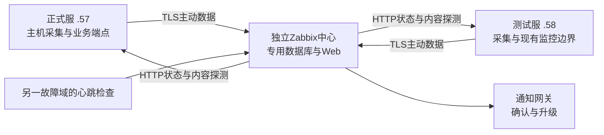

# Zabbix 接入正式服、测试服可行性评估

评估日期：2026-11-26；主机采样 16:54，补充核验 16:58–17:01，时区 Asia/Singapore。正式服 172.30.30.57、测试服 172.30.30.58。仅 SSH 只读元数据和 HTTP GET；未安装、更新、重启、修改防火墙、访问业务记录或注入故障。详细事实见 environment-summary.json。

## 1. 决策结论

**技术可行，建议分阶段接入；当前不具备直接宣布正式上线就绪的条件。** Zabbix 能覆盖主机/容量、业务入口、Docker、告警确认与升级，但当前环境的系统生命周期、既有监控、采集权限和业务实例身份需要先纳入设计。

| 范围 | 结论 | 放行条件 |
| --- | --- | --- |
| 外部 HTTP/主机失联监控 | 可行，适合优先实施 | 确定独立监控节点、来源网络、告警负责人及通知渠道 |
| 正式服 Agent 主机监控 | 有条件可行 | 在测试服验证 EL8 包实际运行、TLS、SELinux、资源和权限；明确过保系统治理责任 |
| 测试服 Agent 主机监控 | 有条件可行 | 先确认已有 Prometheus/node_exporter 的 owner/用途，明确唯一权威告警来源 |
| 两服 Docker 监控 | 可行但须定制目标范围 | 精确业务实例白名单；选择 Docker socket 授权或固定字段采集适配方案；测 Docker26.1.3 与模板兼容 |
| Zabbix Server/数据库直接放生产主机 | 不推荐 | 会与业务故障同生共灭，且增加状态数据库与升级负担 |
| 将测试服作为唯一监控中心 | 不推荐 | 测试有大量并行/历史容器、数据盘80%及自身维护，不应承担唯一生产告警 |
| 自动恢复同时启用 | 当前尚未就绪，单独实施 | 原控制器安装、受支持解释器、依赖健康、既有锁/epoch和通知验收；先测后正式 |

评估完成不等于安装或监控运行验收通过。独立节点、网络和通知尚未指定，只阻塞对应实施与验收，不阻塞本报告完成。

## 2. 本次现场事实

| 项目 | 正式 .57 | 测试 .58 | 对接入的影响 |
| --- | --- | --- | --- |
| OS | CentOS Linux 8 | CentOS Linux 8 | 已结束官方维护，不能当作当前受维护OS |
| 架构/虚拟化 | x86_64 / KVM | x86_64 / KVM | 可评估EL8 Agent2；物理宿主和独立故障域未知 |
| 内核/glibc | 4.18.0-147.el8 / 2.28 | 同左 | 需实际验证二进制、依赖和安全基线，不能只看发行版名 |
| CPU/内存 | 16 vCPU / 31.25 GiB | 16 vCPU / 31.25 GiB | 单次采样有轻量采集余量，不能代表峰值 |
| MemAvailable | 23.19 GiB | 23.90 GiB | 宿主余量不代表每个容器都有余量 |
| 1/5/15分钟负载 | 0.55 / 0.64 / 0.66 | 0.70 / 0.90 / 0.96 | 当前负载较低，不构成长期容量证明 |
| Docker | 26.1.3，overlay2，cgroupfs | 同左 | 官方Docker模板页面列的测试版本为23.0.3，需真实兼容验收 |
| 容器数量 | 16运行 / 201停止 | 178运行 / 356停止 | 不可默认全部发现并报警；停止历史实例需明确排除 |
| Docker盘 | 33%已用，约1261.5 GiB可用 | 80%已用，约393.7 GiB可用 | 测试容量预警优先；保留绝对余量和增长趋势双口径 |
| 根盘 | 28%，约36.4 GiB可用 | 28%，约36.2 GiB可用 | 不把监控长期历史写入业务根盘 |
| inode | 根/Docker约1% | 根1% / Docker2% | 仍需监测但当前非容量瓶颈 |
| 注册前端/后端 | HTTP200 / UP | HTTP200 / UP | HTTP健康采集已有明确入口 |
| 后端Docker健康 | 无Healthcheck | healthy，有Healthcheck | 两服不能复用完全相同健康规则 |
| 后端重启策略 | unless-stopped | no | 测试退出后不会由此策略自动拉起；不在本任务修改 |
| 指定Zabbix RPM/unit | 未安装/未发现 | 未安装/未发现 | 没有证据表明Zabbix已启用，不排除未登记的外部监控 |
| 既有监控进程 | 本轮未发现指定名称进程 | prometheus、node_exporter | 保留原服务；先确认用途和能否复用 |
| 有限恢复unit | not-found | not-found | 代码交付不代表服务器已安装 |
| 系统Python | 3.6.8，PATH未找到3.12 | 同左 | 与现有恢复控制器3.12前提有差距；不是Zabbix Agent本身的Python要求 |
| SELinux | Enforcing | Enforcing | 保持启用，按实际采集路径配置最小策略 |
| NTP | synchronized | synchronized | 监控时间基准正常 |

测试服本轮 MySQL 容器使用约1.946 GiB/2 GiB（97.29%）；这不证明内存泄漏或即将OOM，但说明应按容器上限监测，不只看宿主可用内存。单次Swap使用也不能等同当前换页压力，应采集速率。

初始测试服 loopback HTTP 失败；ss证明服务绑定172.30.30.58，随后通过已登记IP复核200/UP。后续监控必须使用登记入口，不能猜localhost，也不能把初始探测地址错误写成业务宕机。

## 3. 已有 Prometheus 对方案的影响

测试服存在以下真实进程：
- `/opt/intruoyi-monitoring/prometheus`，监听172.30.30.58:19090，TSDB在同目录data，保留参数30d。
- `/opt/intruoyi-monitoring/node_exporter`，监听172.30.30.58:19100。

本轮标准状态API读取失败，维护机返回HTTP400；没有读取或修改其私密配置，版本、目标、规则、告警接收器、维护归属均未证实。不能宣称已有完整监控，也不能认为服务器完全没有监控。

决策门槛：先明确这两个进程属于长期运维还是任务自有验证环境。若已有有效指标，可评估Zabbix对接既有指标入口，或分阶段迁移；若继续保留Prometheus用于应用指标，必须规定Zabbix为哪些事件的唯一告警源，避免两个平台对同一故障重复升级。现阶段不删除、不停止、不覆盖原服务。

## 4. 版本与操作系统

官方生命周期页面当前列：Zabbix8.0 LTS于2026-11-05发布，完整支持至2029-11-30，有限支持至2031-11-30；7.0 LTS完整支持至2027-06-30，有限支持至2029-06-30。

新平台建议以**8.0 LTS为验证候选**，在实施时固定受支持补丁版本和对应模板，通过测试再纳入正式。其刚发布不久，不能把LTS标签当作当前环境已兼容。7.0仍受支持，可作为明确需求下的另一候选，但不设计自动降级或混用模板。

官方EL8仓库存在 `zabbix-agent2-8.0.0-release1.el8.x86_64.rpm`，说明有可供验证的包；本轮没有下载/安装包、验证签名或运行依赖，所以结论是“具备验证路径”，不是“已通过安装验证”。Agent核心不依赖现有Python3.6，有限恢复控制器的3.12要求单独处理。

CentOS Linux8于2021-12-31结束维护。建议把两服OS迁移到受支持发行版列为独立正式改造，不在监控安装中顺手升级内核、Docker、OpenSSL或系统Python。外部HTTP监测和独立中心建设可以先推进；本机采集需明确过保系统风险和治理责任。监控接入本身不解决系统安全更新缺口。

## 5. 推荐部署拓扑与网络

独立运维节点部署 Zabbix Server、Web 和专用数据库；两服只承担必要采集及既有恢复组件。独立指实际物理/存储/网络故障域，不能仅凭新增VM名称认定隔离。当前没有核验可用的新节点，也未访问审查服，不把 .59 自动作为候选。

| 流向 | 用途 | 网络原则 |
| --- | --- | --- |
| 两服Agent → 中心TCP10051 | 主动检查/心跳 | TLS PSK或证书，每主机独立身份；中心仅允许批准来源 |
| 中心 → 两服8081/48081及明确业务端点 | 外部可用性 | 来源限定；检查状态/内容/耗时；未来生产域名/TLS入口另补真实路径 |
| 中心 → Agent TCP10050 | 仅确需被动项目 | 默认不开放；官方Docker模板轮询依赖此路径时，要明确选择及限制来源 |
| 管理网 → 中心443 | 管理/查看 | HTTPS，MFA，正式/测试主机组权限和只读角色分开 |
| 中心 → 企业通知网关 | 告警与恢复通知 | 固定目的端点、凭据保管与真实送达验证 |
| 独立观察点 → 中心 | 监控自监控 | 心跳失联能走独立通知路径 |

不能假定把Agent配置为active就自动使所有官方模板变成active。Linux选择对应主动模板；Docker模板是否保持限制来源的被动采集或使用经过版本控制和测试的主动/固定摘要接入，必须在安装方案中明确。

当前两服firewalld未运行，iptables INPUT/OUTPUT为ACCEPT，DOCKER-USER只有RETURN；正式多个服务监听0.0.0.0/IPv6，测试业务入口指定.58。此事实不足以断言公网开放或完全没有防护：上游ACL以及完整nft/mangle规则未核验。不能直接开启firewalld或全局改iptables；必须按未来明确中心IP审核必要连通路径，保护现有发布和恢复围栏。

## 6. Docker采集权限与目标选择

两服docker.sock为root:docker 0660。官方Docker模板需要采集身份能访问socket；Docker官方明确docker组带来root级权限。将socket挂载为只读文件也不等于Docker API只读。

建议路线：
1. 主机和HTTP监测采用低权限Agent/中心探测，默认禁用任意远程命令。
2. Docker健康与资源优先评估受控固定字段摘要接入：由受保护的本机执行器对登记容器读取必要状态，Agent只读取脱敏摘要；包含时间、采集错误与陈旧判定。这是正式集成开发范围，当前并不存在可直接宣称就绪的适配器。
3. 如果选择官方Agent2 Docker插件直接访问socket，必须明确其高权限边界、限制Agent控制入口、禁用任意system.run、审查凭据及进程完整性，并在测试环境验证。不能称其为零风险只读账号。

正式主系统容器名相对固定；测试后端名称带历史来源前缀，且有大量演练/历史实例。初版以注册profile映射绑定业务角色，不用模糊名称匹配全部容器。历史停止容器纳入资产统计，但不按业务宕机报警；运行临时容器另分组。预期容器消失必须报警，不能被低级别发现的过滤条件自动抹掉。

当前正式后端已有docker.sock挂载是既有权限事实，本次不扩大或移除。后续安全整改独立评估业务依赖。

## 7. 初版监控项与告警规则

| 层级 | 初版项目 | 建议采集/告警设计 |
| --- | --- | --- |
| 主机 | Agent心跳、负载、CPU、可用内存、swap速率、磁盘/inode、时钟 | 30–60秒采集，连续窗口抑制抖动，保留原始时间 |
| 服务入口 | 前端200、后端HTTP200且顶层status=UP、响应耗时、展厅/必要助手 | 15–30秒起步，连续失败后通知；不把HTTP200等同全部业务验收 |
| Docker | 登记容器存在/状态/健康、重启/OOM、CPU、内存相对上限 | 30–60秒；精确角色绑定；健康未配置显示未配置 |
| 依赖 | MySQL、Redis、MinIO健康和容量 | 先复用已有语义探测；深入插件需要专用最小权限账号，不能为监控对公网开放数据库 |
| 备份 | 最后已验证成功点、年龄、连续链状态、任务超时 | 1–5分钟读取原权威记录；备份完成与恢复证明分别显示 |
| 发布/恢复 | 维护状态、原任务失败/未知、控制器启用/暂停/预算/心跳 | 状态适配需开发；原历史不改写，未知不能算健康 |
| 监控自身 | Server/Agent队列、DB容量、采集失败、通知失败、外部心跳 | 数据过期与服务故障分别报警，监控宕机仍能通知 |

磁盘初始阈值可讨论为80%预警、90%严重，但必须叠加绝对余量与增长预测；测试盘80%意味着应先关注容量，而非自动清理。业务SLO、正常响应基线、维护时间和值班负责人尚未确认，不把建议值当批准标准。

告警按environment/service/severity/owner路由：正式高优先级，测试常规故障走低优先级。主机失联抑制从属服务风暴；故障去重、人员确认、未确认升级和恢复通知都有记录。DELIVERED不等于人员ACK；不以静默替代处理或恢复。

安全覆盖边界：可按明确规则监控登录失败计数、证书到期、关键服务/端口漂移和采集身份异常，但这些需要授权日志范围与基线。Zabbix接入不能代替OS补丁治理、漏洞管理、终端防护或集中安全审计。本轮未做漏洞扫描、登录日志审计或公网暴露测试，不把未检查项写为安全合格。

灾备覆盖边界：接入应分别展示“最近备份成功时间”“最近恢复演练成功时间”“复制/连续链延迟”“备份存储可用性”，并对状态缺失或过期报警。RPO（允许丢失多久的数据）与RTO（允许恢复多久）须由业务确定；前者需要链连续性及复制证据，后者需要实际恢复演练。本轮未读取备份链或执行恢复，因此不作灾备达标结论。中心和通知若与生产共用宿主、存储或出口，应记录共同失效风险；备份监控配置也不能替代异故障域副本和离线恢复流程。

## 8. 与Spug和有限恢复衔接

Zabbix负责发现、记录、通知；Spug负责发布；现有service_recovery负责有限前后端恢复。不能由Zabbix告警和控制器同时直接重启同一容器。

发布前分别确认控制器pause与Zabbix维护窗口成功，发布/备份恢复共同锁及epoch继续有效；发布后核真实业务健康和新容器身份，再显式重新arm、结束维护。维护窗超时必须可见，不能永久抑制故障。

现阶段两服都未安装该unit，系统默认Python3.6.8且PATH未发现3.12；没有穷举磁盘寻找私有解释器，不断言机器绝无3.12。还需核真实依赖healthcheck、source epoch/共同锁和通知配置。正式MinIO无Docker Healthcheck；测试MySQL/Redis也未配置；原控制器对dependencies要求healthy，不能简单照抄示例或把依赖清空来放行。正式后端与测试后端重启策略不同，也需在未来任务明确治理，不能由Zabbix接入顺便改变。

因此第一阶段只上线监测告警，有限恢复另在授权测试实例验证假死、依赖失败、维护暂停、预算耗尽、未知结果等，再按批准范围进入正式。不能为了验收在正常正式服注入故障。

## 9. 数据库、资源与维护成本

Zabbix8.0官方要求PostgreSQL15–18或MySQL8.4起等受支持数据库。现场正式业务MySQL8.0.39不满足其MySQL后端最低要求；无论版本是否符合，都不建议共用业务数据库实例。

建议独立中心初始预算 **4 vCPU、8 GiB内存、100–200 GiB SSD**，专用PostgreSQL16（确认所选Zabbix补丁对应兼容表），初版不强制TimescaleDB和双节点HA。该值是少量主机及明确业务容器白名单的规划起点，不是性能保证。若纳管测试全部178个运行容器，必须重新按监控项数和频率测算。

可先规划明细历史14–30天、趋势180–365天，再由存储增长和事件追溯需求决定；监控历史不替代法规业务归档。写入速率按监控项数/周期累计，不能仅用主机数量估算。例：2000个每60秒采样项约33值/秒、每天288万值，最终空间取决于类型、索引、压缩与保留策略。

试运行实测Agent CPU/RSS、采集耗时、磁盘/DB增长和告警队列；不给“完全无性能影响”的承诺。中心应有配置/模板/数据库备份、密钥独立保管、版本固定和恢复步骤；Zabbix Server HA不自动提供数据库HA或异地通知保障。

预计在独立节点、网络和通知条件具备后，标准监测接入和模板调优约3–5个工程人日，业务状态/维护联动适配另约2–4个工程人日；现有监控梳理、系统迁移、深度DB指标和自动恢复单独估算。以上是范围估计，不含采购、审批等待和试运行观察时间。

## 10. 分阶段实施、回退和验收

1. **准备**：确认独立监控节点/故障域、中心IP/DNS、通知负责人/渠道、既有Prometheus归属、版本/包签名/依赖、采集权限及保留周期。未具备项只阻塞对应动作。
2. **中心搭建和测试监测**：部署独立中心/DB，先外部HTTP，再测试Agent/TLS/主机项；精确Docker白名单；原Prometheus不动。测试环境先观察至少48–72小时，并覆盖一次真实发布维护周期；观察长度是建议，关键场景未通过不能仅靠到时放行。
3. **正式监测**：复用已验证模板和独立主机身份，仅采集；确认真实通知接收/ACK/升级/恢复、主机失联和监控失联检测。正式故障场景用测试等效演练及非破坏性心跳验证，不停正式业务做证明。
4. **业务衔接**：新增备份年龄/恢复状态和Spug维护协同，按BDD与严格TDD开发；页面验收遵循真实Playwright路径。
5. **有限恢复**：独立范围解决解释器、依赖healthcheck、锁/epoch、日志预算和故障测试后实施，不作为基础监测的隐含附带操作。

验收场景（未来实施须记录Given/When/Then与实际证据）：
- Given后端进程存活但HTTP失败，When超过连续失败窗口，Then报警可确认升级；开启恢复时只由唯一控制器在许可条件下操作。
- Given主机或监控中心失联，When心跳过期，Then从独立路径通知，旧健康状态不继续展示。
- Given正在发布/备份恢复，When业务暂不可用，Then正确记录维护且零误重启；窗口过期可见。
- Given历史容器停止/预期业务容器消失，Then分别不误报/必须报警。
- GivenDocker接口拒绝或数据库采集失败，Then显示采集失败，不以0或空值表示正常。
- Given通知接口成功但无人确认，Then继续按升级策略处理；通知接口失败单独可见。
- Given备份任务成功记录已超期，Then按业务批准阈值报警，不以目录存在当作恢复就绪。

回退：只停止和移除本任务新增Agent/中心资源、撤销本任务精确网络规则及适配调用，保留原业务、原Prometheus、发布锁、备份链和失败证据；监控数据库先备份再做版本回退，不能简单降级二进制。安装任务另记原配置/目标路径/进程身份，禁止全局清理Docker或iptables。

## 11. 实施前剩余条件

- 独立中心的实际主机、物理故障域、存储与备份位置未指定，不能验证实际10051/443/HTTP路径。
- 现有Prometheus归属和有效覆盖未确认，标准API400原因未知；不扩大为更换服务。
- Zabbix Agent2实际RPM签名/依赖/TLS/SELinux和Docker26.1.3兼容尚未安装验证。
- Docker高权限直连或固定摘要接入路线需明确；备份与控制器状态适配未实现。
- 通知渠道、升级负责人、SLO、备份年龄目标和容量策略未批准，不能承诺告警达标。
- 两服过保OS治理、主机/上游网络边界、自动恢复解释器与依赖健康需对应任务处理。

## 12. 官方依据

- Zabbix生命周期：https://www.zabbix.com/life_cycle_and_release_policy
- Zabbix8.0依赖、容量示例及端口：https://www.zabbix.com/documentation/8.0/en/manual/installation/requirements
- 官方EL8 Agent2包目录：https://repo.zabbix.com/zabbix/8.0/stable/rhel/8/x86_64/
- Docker官方Zabbix集成、模板默认发现与socket权限：https://www.zabbix.com/integrations/docker
- Zabbix协议兼容：https://www.zabbix.com/documentation/8.0/en/manual/appendix/compatibility
- 主动/被动协议：https://www.zabbix.com/documentation/7.0/en/manual/appendix/items/activepassive
- TLS：https://www.zabbix.com/documentation/7.0/en/manual/encryption
- CentOS Linux8结束维护：https://www.centos.org/centos-linux-eol/
- Docker组root级权限：https://docs.docker.com/engine/install/linux-postinstall/

7.0文档仅用于已核通用主动/被动与TLS语义；具体8.0安装参数必须按选定补丁版本文档验证，不能混用模板。所有建议阈值、资源和人日均为工程估计；服务器事实以本轮快照时间为界。
